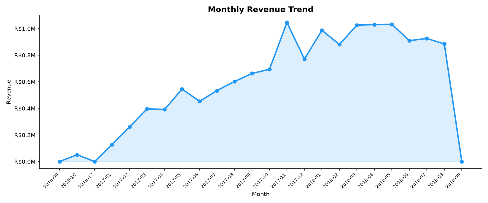
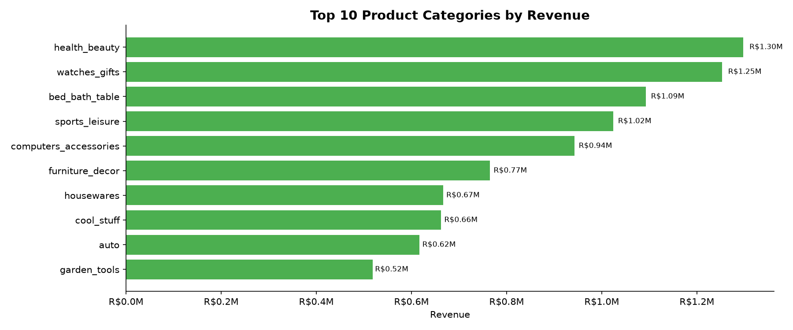
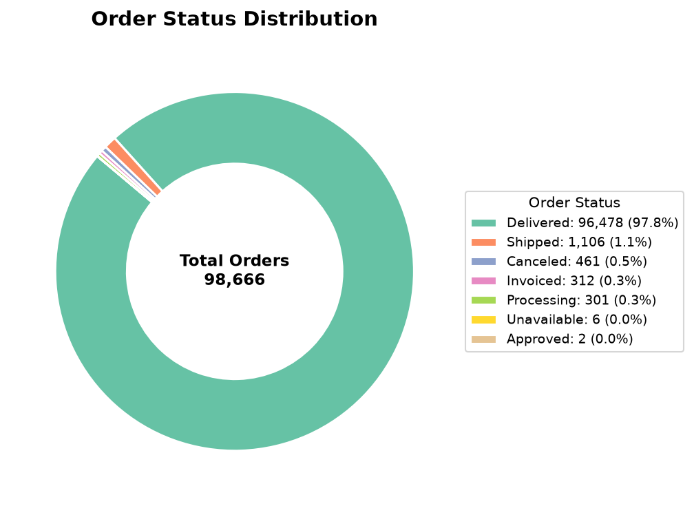
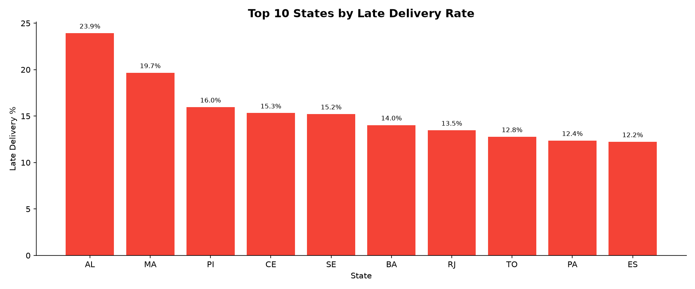
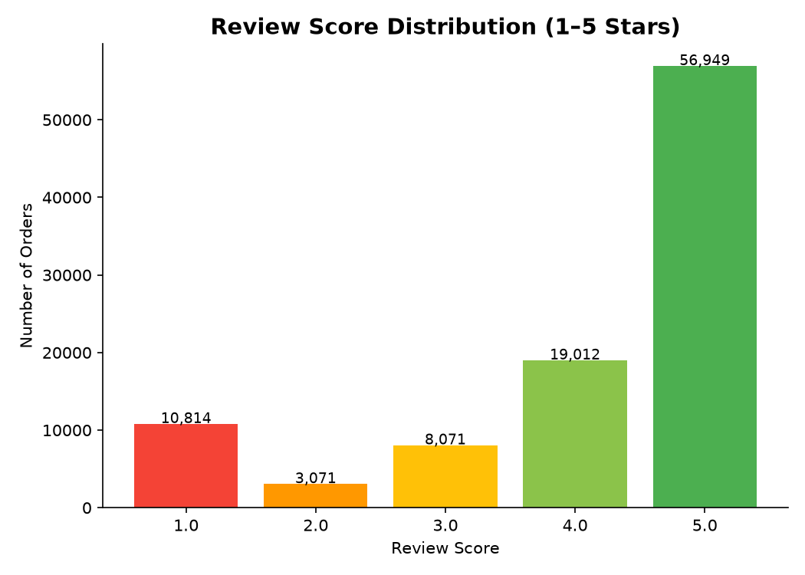
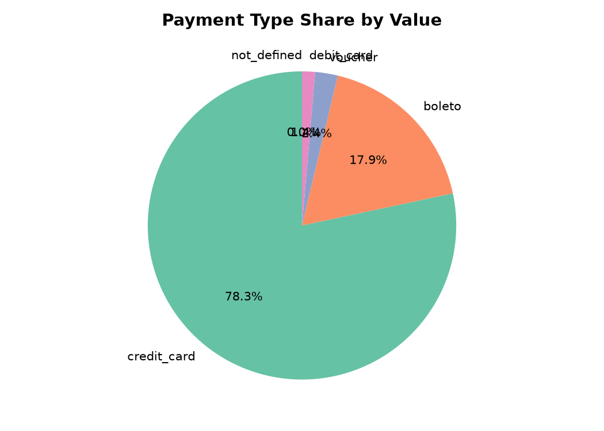
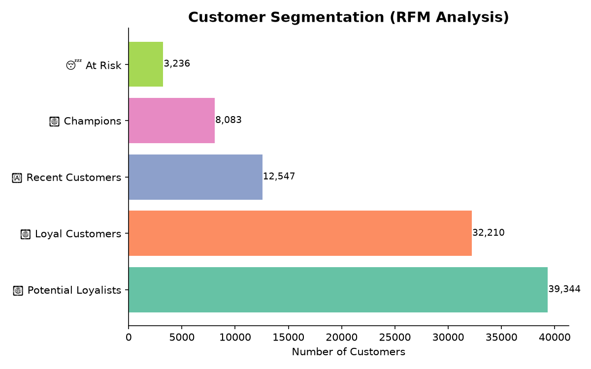
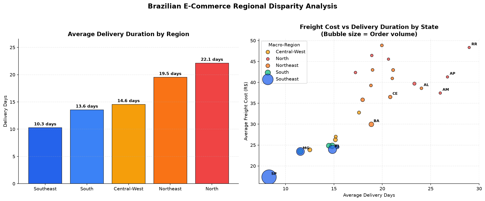

# 🛒 Olist Brazilian E-Commerce — Full Stack Data Analytics Project

<p align="center">
  
  
  
  
  
  
</p>

---

## 📌 Project Overview

An end-to-end **Full-Stack Data Analytics** project built on the real-world **Brazilian E-Commerce dataset by Olist** (Kaggle). This project covers the complete data pipeline — from raw CSV ingestion into a relational database, through a star-schema data warehouse layer, to interactive Power BI dashboards and Python-based exploratory data analysis with RFM customer segmentation.

> **Dataset**: 100,000+ orders placed on Olist marketplace between 2016 and 2018, spanning 9 relational tables covering orders, customers, products, sellers, payments, reviews, and geolocation.

---

## 🎯 Business Questions Answered

- 📈 How has revenue grown month over month? What are the seasonal patterns?
- 🏆 Which product categories generate the most revenue?
- 🗺️ Where are our customers concentrated geographically (by Brazilian state)?
- 🚚 What is our on-time delivery rate? Which states have the worst delays?
- ⭐ How satisfied are customers? Does late delivery hurt review scores?
- 💳 What payment methods do customers prefer?
- 👥 Who are our most valuable customers? (RFM Segmentation)
- 🏪 Which sellers drive the most revenue?

---

## 🗂️ Project Structure

```
olist-ecommerce-analytics/
│
├── 📁 data/
│   └── raw/                          # 9 Olist CSV datasets (not tracked by git)
│
├── 📁 sql/
│   ├── 01_schema/
│   │   ├── create_tables.sql         # DDL: All 9 raw tables
│   │   └── foreign_keys.sql          # Relational constraints
│   ├── 02_load/
│   │   └── load_csv.sql              # COPY commands to load CSVs
│   ├── 03_indexes/
│   │   └── create_indexes.sql        # Performance indexes
│   ├── 04_views/
│   │   └── bi_views.sql              # Star Schema BI Views
│   └── 05_date_dim/
│       └── date_dim_dax.txt          # Power BI DimDate (DAX)
│
├── 📁 python/
│   ├── eda_analysis.py               # EDA + RFM Segmentation script
│   └── geospatial_analysis.py        # Brazil Regional & Geospatial Logistics script
│
├── 🚀 app.py                         # Streamlit Interactive Web App + AI ML Predictor
│
├── 📁 powerbi/
│   └── ecom.pbix                     # Power BI Dashboard (8 pages)
│
├── 📁 reports/                       # Auto-generated charts & analysis output
│   ├── 01_monthly_revenue_trend.png
│   ├── 02_top10_categories_revenue.png
│   ├── 03_order_status_distribution.png
│   ├── 04_late_delivery_by_state.png
│   ├── 05_review_score_distribution.png
│   ├── 06_payment_type_share.png
│   ├── 07_rfm_segmentation.png
│   ├── 08_brazil_geospatial_density.png
│   ├── rfm_customer_segments.csv
│   └── state_logistics_metrics.csv
│
├── 📄 requirements.txt
├── 📄 .gitignore
└── 📄 README.md
```

---

## 🛠️ Tech Stack

| Layer | Tool | Purpose |
|:---|:---|:---|
| **Storage** | PostgreSQL 16 | Relational database for raw + modeled data |
| **Modeling** | SQL (Views) | Star schema — fact & dimension tables |
| **BI Dashboard** | Power BI Desktop | DirectQuery dashboards, DAX measures |
| **Analytics** | Python 3.14 | EDA, charts, RFM customer segmentation |
| **Libraries** | Pandas, NumPy, Matplotlib, Seaborn | Data processing & visualization |

---

## 📊 Key Business KPIs

| Metric | Value |
|:---|:---:|
| 💰 Total Revenue | **R$ 14,209,250** |
| 🛒 Total Orders | **98,666** |
| 👥 Unique Customers | **95,420** |
| 📦 Avg Order Value (AOV) | **R$ 144.01** |
| ✅ On-Time Delivery Rate | **92.2%** |
| ⭐ Avg Customer Review Score | **4.03 / 5.0** |
| 🚚 Avg Delivery Duration | **12.0 days** |

---

## 📈 EDA Charts & Insights

### 1. Monthly Revenue Trend

> Revenue grew steadily from mid-2017 with a strong peak in **November 2017** (Black Friday effect), followed by consistent high performance through mid-2018.

---

### 2. Top 10 Product Categories by Revenue

> **Health & Beauty**, **Watches & Gifts**, and **Bed, Bath & Table** are the top 3 revenue-driving categories — together contributing over 30% of total revenue.

---

### 3. Order Status Distribution

> Over **96%** of all orders were successfully delivered. Cancelled and unavailable orders account for less than 4%, indicating strong fulfillment operations.

---

### 4. Late Delivery Rate by State

> States in the **North and Northeast regions** (e.g., AM, AL, RR) have the highest late delivery rates — primarily due to long distances from São Paulo logistics hubs.

---

### 5. Review Score Distribution

> **57%** of orders received a perfect 5-star review. Only **11%** gave 1 or 2 stars, suggesting a generally strong customer experience despite some delivery delays.

---

### 6. Payment Type Share

> **Credit card** dominates at ~73% of total payment value. Boleto (Brazilian bank slip) is second at ~19%, while vouchers and debit cards are minimal.

---

### 7. RFM Customer Segmentation


| Segment | Customers | Avg Recency | Avg Spend |
|:---|---:|---:|---:|
| 🏆 Champions | 8,083 | 98 days | R$ 313.8 |
| 💛 Loyal Customers | 32,210 | 181 days | R$ 198.5 |
| 🔄 Potential Loyalists | 39,344 | 270 days | R$ 114.3 |
| 🆕 Recent Customers | 12,547 | 361 days | R$ 53.8 |
| 😴 At Risk | 3,236 | 443 days | R$ 33.5 |

> **41% of customers** (Potential Loyalists) are the best re-engagement opportunity — they purchased recently enough to win back with targeted offers.

---

### 8. Brazil Regional Disparities & Logistics Lead Times


| Macro-Region | Delivered Orders | Avg Delivery Days | Avg Freight (R$) | Late Delivery Rate (%) |
|:---|---:|---:|---:|---:|
| 🏙️ **Southeast** (SP, RJ, MG, ES) | 66,200 | **10.3 days** | **R$ 19.84** | **7.5%** |
| 🌾 **South** (PR, SC, RS) | 13,814 | **13.6 days** | **R$ 24.35** | **7.1%** |
| 🏜️ **Central-West** (DF, GO, MT, MS) | 5,624 | **14.6 days** | **R$ 26.49** | **8.0%** |
| 🏖️ **Northeast** (BA, PE, CE, etc.) | 9,044 | **19.5 days** | **R$ 35.99** | **14.3%** |
| 🌳 **North** (AM, PA, RO, etc.) | 1,796 | **22.1 days** | **R$ 41.35** | **9.8%** |

> **Key Logistics Takeaway**: The **Southeast region** accounts for 68% of e-commerce volume and benefits from the lowest freight and fastest deliveries (10 days). In contrast, the **North and Northeast** suffer from transit bottlenecks resulting in **double the freight cost** and delivery times reaching up to **22 days**. Setting up regional distribution centers in the Northeast would directly resolve late delivery complaints and improve review ratings.

---

## 🗄️ Database Architecture

### Entity-Relationship Overview

```
olist_customers_dataset
        │
        │ (1:N)
        ▼
olist_orders_dataset ────────────── olist_order_items_dataset
        │                                    │              │
        │ (1:N)                         (N:1)│          (N:1)│
        ▼                                    ▼              ▼
olist_order_payments_dataset    olist_products_dataset  olist_sellers_dataset
olist_order_reviews_dataset              │
                                         │ (N:1)
                                         ▼
                             product_category_name_translation
```

### BI Views (Star Schema)

| View | Type | Description |
|:---|:---|:---|
| `bi_fact_sales` | ⭐ Fact | Central table — joins all dims, used in Power BI |
| `bi_fact_order` | Fact | Order-level with delivery timing & customer info |
| `bi_dim_product` | Dimension | Products with English category names & volume |
| `bi_fact_review_latest` | Fact | De-duplicated latest review per order |
| `bi_payments_order` | Fact | Aggregated payments per order (handles split payments) |

---

## ⚙️ How to Run This Project

### Prerequisites
- [PostgreSQL 16+](https://www.postgresql.org/download/) + pgAdmin 4
- [Python 3.8+](https://www.python.org/downloads/)
- [Power BI Desktop](https://powerbi.microsoft.com/desktop/) (Windows only)
- [Olist Dataset](https://www.kaggle.com/datasets/olistbr/brazilian-ecommerce) from Kaggle

---

### Phase 1 — Database Setup

```sql
-- 1. Create the database in pgAdmin or psql
CREATE DATABASE olist_db;
```

Then run scripts in this exact order in pgAdmin Query Tool:

```
sql/01_schema/create_tables.sql     → Creates 9 raw tables
sql/02_load/load_csv.sql            → Loads CSVs (update path first!)
sql/01_schema/foreign_keys.sql      → Adds FK constraints
sql/03_indexes/create_indexes.sql   → Creates performance indexes
sql/04_views/bi_views.sql           → Builds the BI star schema views
```

> ⚠️ **Before running `load_csv.sql`**: Open the file and update the CSV path to match your local machine's path to `data/raw/`.

---

### Phase 2 — Python EDA

```bash
# Clone the repo
git clone https://github.com/Manojgs001/olist-ecommerce-analytics.git
cd olist-ecommerce-analytics

# Install dependencies
pip install -r requirements.txt

# Run EDA (charts auto-saved to /reports folder)
python python/eda_analysis.py
```

---

### Phase 3 — Launch the Interactive Streamlit Web App & AI Predictor 🚀

```bash
# Launch the live interactive web dashboard
streamlit run app.py
```
> Features:
> - 📊 Dynamic KPI summary cards & monthly revenue trend
> - 🗺️ State-level filtering & category breakdown
> - 👥 Interactive RFM Customer Segment Explorer
> - 🔮 **AI Delivery Risk Predictor**: Real-time Machine Learning model (Random Forest) predicting delivery delays with interactive parameter sliders!
> - 💡 Executive Briefing & strategic business recommendations

---

### Phase 4 — Power BI Dashboard

1. Open `powerbi/ecom.pbix` in Power BI Desktop
2. `Home → Transform Data → Data Source Settings` → Update PostgreSQL connection
3. Set connection mode to **DirectQuery**
4. Load views: `bi_fact_sales`, `bi_fact_order`, `bi_dim_product`, etc.
5. Create DimDate: `Modeling → New Table` → paste DAX from `sql/05_date_dim/date_dim_dax.txt`
6. Connect: `DimDate[Date]` → `bi_fact_sales[purchase_date]`

---

## 📋 Power BI Dashboard Pages

| Page | Key Visuals |
|:---|:---|
| **1. Overview** | KPI cards, Revenue trend, Top categories map, Order status donut |
| **2. Sales Trends** | Revenue vs Last Year, YTD Area chart, Category × Month matrix |
| **3. Category & Products** | Treemap, AOV vs Orders scatter, Rating by category |
| **4. Customer Geo** | Filled map by state, Top 10 states, State × Category matrix |
| **5. Delivery & Logistics** | On-time %, Late orders by month, Late % by state, Delivery days by category |
| **6. Reviews** | Rating distribution donut, Rating by category, Late vs On-time rating |
| **7. Payments** | Payment type donut, Avg installments, Payment value trend |
| **8. Sellers** | Top sellers, Revenue per seller, Seller state map |

---

## 💡 Key Business Recommendations

1. **Target Potential Loyalists** (39K customers) with a re-engagement email campaign offering 10–15% off their second order — highest ROI segment.
2. **Improve North/Northeast logistics** — states like AM and AL show 20%+ late delivery rates. Partner with regional carriers or add distribution centers.
3. **Boost Health & Beauty category** — highest revenue category with strong review scores. Increase seller onboarding in this vertical.
4. **Promote credit card installments** — 73% of revenue is credit card. Offering more installment plans (parcelamento) could increase AOV further.
5. **Address 1-star reviews** — 11% negative reviews correlate strongly with late deliveries. Proactive SMS/email delivery updates can reduce complaints.

---

## 📦 Dataset Information

| Table | Description | Rows |
|:---|:---|---:|
| olist_orders_dataset | Orders with status & timestamps | 99,441 |
| olist_order_items_dataset | Line items — price & freight | 112,650 |
| olist_customers_dataset | Customer IDs & locations | 99,441 |
| olist_products_dataset | Product attributes & categories | 32,951 |
| olist_sellers_dataset | Seller IDs & locations | 3,095 |
| olist_order_payments_dataset | Payment type, installments, value | 103,886 |
| olist_order_reviews_dataset | Star ratings & comments | 99,224 |
| olist_geolocation_dataset | Zip code lat/lng coordinates | ~1M |
| product_category_name_translation | Portuguese → English categories | 71 |

---

## 👤 Author

**Manoj**
- 📧 Data Analyst | SQL · Python · Power BI
- 🔗 [GitHub Profile](https://github.com/Manojgs001) | [Repository](https://github.com/Manojgs001/olist-ecommerce-analytics)

---

## 📄 License

This project is open source under the [MIT License](LICENSE).  
Dataset sourced from [Kaggle — Brazilian E-Commerce by Olist](https://www.kaggle.com/datasets/olistbr/brazilian-ecommerce) under CC BY-NC-SA 4.0.

---

<p align="center">⭐ If you found this project helpful, please star the repository!</p>
